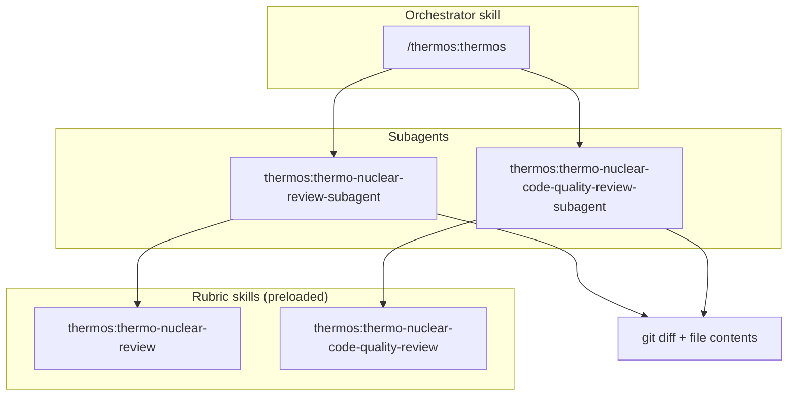

# Thermos plugin

Thermo-nuclear branch review for Claude Code: deep correctness and security audits, harsh maintainability rubrics, and parallel subagent orchestration.

## Installation

In Claude Code, add the marketplace once, then install the plugin:

```text
/plugin marketplace add Yonhir/cursor_plugins
/plugin install thermos@cursor-plugins
```

## Architecture



## Skills

| Skill | Invocation | Description |
|:------|:-----------|:------------|
| `thermos:thermos` | You run `/thermos:thermos` (Claude never starts it on its own) | Run both review subagents in parallel and synthesize findings. |
| `thermos:thermo-nuclear-review` | Claude or the subagents only (hidden from the `/` menu) | Deep branch audit (bugs, breakages, security, devex, feature-gate leaks). |
| `thermos:thermo-nuclear-code-quality-review` | Claude or the subagents only (hidden from the `/` menu) | Strict maintainability audit (code-judo, 1k-line rule, spaghetti, boundaries). |

## Agents

| Agent | Description |
|:------|:------------|
| `thermos:thermo-nuclear-review-subagent` | Deep review subagent (diff-scoped). Preloads the `thermo-nuclear-review` rubric. |
| `thermos:thermo-nuclear-code-quality-review-subagent` | Code-quality subagent (diff-scoped). Preloads the `thermo-nuclear-code-quality-review` rubric. |

## Typical usage

**Double review:** run `/thermos:thermos`. Claude then:

1. Gathers `git diff main...HEAD` and the full contents of the changed files.
2. Launches both subagents with the Agent tool in one message, so they run in parallel in the background.
3. Synthesizes prioritized, deduplicated findings.

**Single review:** ask Claude for a deep review or a thermo-nuclear code quality review, or mention one subagent directly, such as `@agent-thermos:thermo-nuclear-review-subagent`, after the diff context is in the conversation.

## License

MIT
